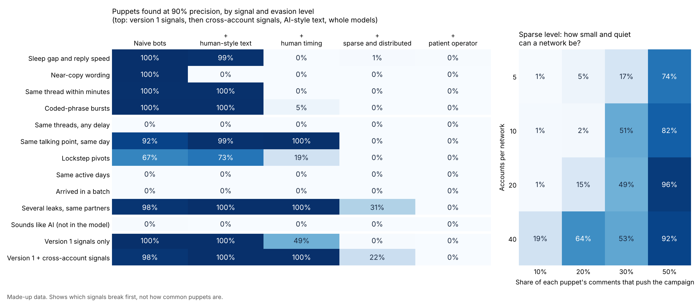

# Red team: which signals survive smarter sock puppets?

Run on 2026-11-14 with `python -m ea redteam`. Made-up data: 25 worlds for the evasion
ladder and 48 for the frontier, each about 2,080 accounts of which 80 are puppets.

## What it shows

1. **Rewording alone hides nothing.** Human-style text kills only the near-copy
   wording signal. Bots that still reply in seconds and pile into the same threads
   are caught 100% of the time by the version 1 signals.
2. **Human timing blinds version 1.** Once each persona keeps human hours and human
   reply delays, every version 1 signal drops to about zero on its own. The
   cross-account signal "same talking point, same day" still finds 100%, because a
   ring pushing the same points on the operator's days looks nothing like chance.
3. **Sparse and distributed is the real fight.** One puppet per thread and 30%
   campaign comments hidden in ordinary cover: no single signal finds anyone. What
   still works is two weak leaks pointing at the same partners: "the accounts that
   share my talking points also first appeared in the same day or two as me". That
   finds roughly a fifth to a half of puppets (21% to 46% across test worlds).
   Remove the batch check and it drops to 18%; batch arrival alone finds 0%.
4. **A patient operator is invisible to this detector.** Accounts made over months,
   no shared push days, new talking points picked up no faster than real people do:
   0% found. Such a network behaves like a real fan community, by construction.
5. **Evasion costs the operator reach.** The same 80 accounts deliver about 1,800
   campaign comments per world as a swarm and about 550 once sparse: under a third.
   The frontier table shows the squeeze: with 10% campaign comments a network is
   nearly invisible, with 50% it is found 74% to 96% of the time.
6. **False flags stay roughly constant, so precision falls as puppets get harder.**
   At the cut-off chosen on train worlds, about 0.5% of real accounts are flagged at
   every level. Against easy puppets that is 89% to 94% precision; at the sparse level
   it is 70%, below the 90% target.
7. **The worst false flags are real coordination.** Organic brigades (real users
   following one link) are flagged at 3.8% and fan communities at 1.2%, against 0.3%
   for ordinary accounts. Behavior alone cannot tell a real brigade from a ring.
   People who polish posts with AI (0.25%), power users, moderators and cross-posters
   (0%) are not a problem for behavioral signals.
8. **"Sounds like AI" flags the wrong people.** Ranking accounts by machine-sounding
   wording puts real people who polish or translate their posts at the top and almost
   no puppets. That result follows from an assumption (people who polish openly sound
   more machine-like than an LLM told to imitate a person), so read it as a
   base-rate argument, not a measurement.

## What to build first

1. Talking-point clustering on real comments (text embeddings, then clusters), since
   every surviving signal depends on knowing two comments push the same point.
2. "Same talking point, same day" and the fused partner checks from
   `ea/network_features.py`.
3. A first-seen date per account, better an account creation date: it is the
   tie-breaker that makes the sparse level detectable at all.
4. Network-level review for anything flagged through shared partners, so an organic
   brigade is looked at as a group before any account in it is labeled.
5. Keep the version 1 signals. They cost little and still catch every lazy operator.

## Limits

- The leaks at the sparse level (batch start, shared push days, fast pivots) are
  assumptions about how a hasty operator works. Provider threat reports describe all
  three in real operations ([THREAT_REPORTS.md](THREAT_REPORTS.md)), but their size
  here is a guess.
- Talking-point detection is a stand-in that finds about two thirds of on-point
  comments with 99% purity. Real embeddings may do better or worse.
- Puppets are 3.8% of accounts. Precision at a given recall falls if the real share
  is lower.
- Persona drift and hijacked accounts are not modeled.
- Results rank signals and show where they break. They do not estimate how common
  puppets are on Reddit.

## Tables

Made-up data. Each cell is recall at 90% precision: the share of puppet accounts found
when at most 1 flag in 10 may land on a real person. Mean over test worlds of about
2080 accounts, 80 of them puppets.
Each column keeps the evasions of the columns to its left.

### One signal family at a time (trained at the same level: its best case)

| Signal family | Naive bots | + human-style text | + human timing | + sparse and distributed | + patient operator |
| --- | ---: | ---: | ---: | ---: | ---: |
| Sleep gap and reply speed | 100% | 99% | 0% | 1% | 0% |
| Near-copy wording | 100% | 0% | 0% | 0% | 0% |
| Same thread within minutes | 100% | 100% | 0% | 0% | 0% |
| Coded-phrase bursts | 100% | 100% | 5% | 0% | 0% |
| Same threads, any delay (new) | 0% | 0% | 0% | 0% | 0% |
| Same talking point, same day (new) | 92% | 99% | 100% | 0% | 0% |
| Lockstep pivots (new) | 67% | 73% | 19% | 0% | 0% |
| Same active days (new) | 0% | 0% | 0% | 0% | 0% |
| Arrived in a batch (new) | 0% | 0% | 0% | 0% | 0% |
| Several leaks, same partners (new) | 98% | 100% | 100% | 31% | 0% |
| Sounds like AI (not in the model) (new) | 0% | 0% | 0% | 0% | 0% |

### Whole models trained on all levels mixed

| Model | Naive bots | + human-style text | + human timing | + sparse and distributed | + patient operator |
| --- | ---: | ---: | ---: | ---: | ---: |
| Version 1 signals only | 100% | 100% | 49% | 0% | 0% |
| Version 1 + cross-account signals | 98% | 100% | 100% | 22% | 0% |
| Campaign comments per world | 1703 | 1835 | 1790 | 535 | 572 |

### The honest operating point

Cut-off chosen on train worlds only, then applied to unseen test worlds.
Each cell: precision / recall.

| Model | Naive bots | + human-style text | + human timing | + sparse and distributed | + patient operator |
| --- | ---: | ---: | ---: | ---: | ---: |
| Version 1 signals only | 95% / 100% | 95% / 100% | 91% / 48% | 14% / 1% | 0% / 0% |
| Version 1 + cross-account signals | 89% / 98% | 89% / 100% | 94% / 100% | 70% / 42% | 21% / 4% |

### Negative controls: real accounts that must not be flagged

Share of each kind flagged at the honest operating point, pooled over all levels.

| Kind of real account | Accounts tested | Version 1 signals only | Version 1 + cross-account signals |
| --- | ---: | ---: | ---: |
| Ordinary accounts | 18840 | 0.24% (46) | 0.33% (63) |
| Fast news followers | 1500 | 0.00% (0) | 0.00% (0) |
| Fan communities (shared favourite talking points) | 1080 | 0.00% (0) | 1.20% (13) |
| People who polish their posts with AI | 2400 | 0.00% (0) | 0.25% (6) |
| Non-native speakers using a translator | 900 | 0.56% (5) | 0.67% (6) |
| Power users and moderators (fixed hours, fast replies) | 600 | 0.00% (0) | 0.00% (0) |
| People who paste their own comment in several threads | 600 | 0.00% (0) | 0.00% (0) |
| Organic brigades (real users arriving from one link) | 1125 | 0.00% (0) | 3.82% (43) |
| New accounts made during breaking news | 2955 | 0.34% (10) | 0.81% (24) |

Disclosed bots: 3 per world, set aside by rule before scoring. Scored: 0.

### Why "sounds like AI" is not in the model

Flag the accounts with the most machine-register wording, as many as there are puppets.
Who gets flagged?

| Level | Puppets | People polishing with AI | Translator users | Other real people |
| --- | ---: | ---: | ---: | ---: |
| Naive bots | 0% | 75% | 25% | 0% |
| + human-style text | 0% | 75% | 25% | 0% |
| + human timing | 0% | 75% | 25% | 0% |
| + sparse and distributed | 2% | 73% | 25% | 0% |
| + patient operator | 1% | 74% | 25% | 0% |

### Frontier at the sparse level: network size x share of comments that are campaign

| Accounts per network | 10% campaign | 20% campaign | 30% campaign | 50% campaign |
| --- | ---: | ---: | ---: | ---: |
| 5 | 1% | 5% | 17% | 74% |
| 10 | 1% | 2% | 51% | 82% |
| 20 | 1% | 15% | 49% | 96% |
| 40 | 19% | 64% | 53% | 92% |
