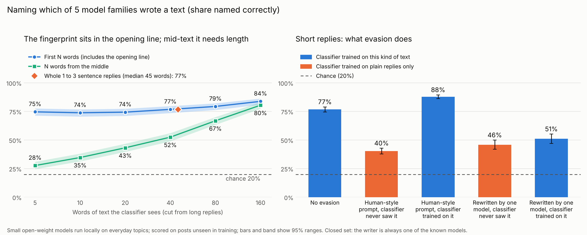

# Model fingerprints: can a classifier name the model family behind a short reply?

Run on 2026-11-14 with `python -m ea fingerprint-generate` (about 5 hours on 4 CPU cores)
and `python -m ea fingerprint` (2 minutes). Numbers: [results.json](results.json).



## Answer in one paragraph

Yes, in a lab setting, and more easily than we assumed. With five known model families
and nothing done to hide them, a simple style classifier names the family behind a
1 to 3 sentence reply 77% of the time (chance 20%), and behind a 200-word reply 87% of
the time. Most of that signal on short text is the **opening line**: the first 5 words
alone give 75%, while 5 words from the middle of a text give 28%. A "write like a casual
human" prompt and a rewrite by another model each roughly halve the accuracy of a
classifier that has not seen the trick, but neither erases the fingerprint, and a
classifier trained on human-style text does better than on plain text (88%). None of
this says whether a text was written by a model at all: no human text was in the test.

## What was measured

Setup: seven small open-weight models ran on this machine with no API and no key.
Each answered the same made-up posts on everyday topics (cookware, bikes, houseplants;
nothing political) at the same sampling settings. The classifier is a standard style
baseline (character and word n-grams, linear model) and is always scored on posts it
never saw in training. Refusals were dropped and formatting quirks stripped first
(curly quotes, wrapping quotes, markdown, line breaks).

Main run: five families with 300 short and 150 long replies each (Llama 3.2 1B,
Qwen 2.5 1.5B, Gemma 3 1B, SmolLM2 1.7B, Falcon3 1B). Seven-family run: the same plus
DeepSeek R1 distill 1.5B and Ministral 3B, on the 120 short and 50 long posts those two
slower models answered.

| Measured | 5 families (chance 20%) | 7 families (chance 14%) |
|---|---|---|
| Whole 1 to 3 sentence reply (median 45 words) | **77%** (75 to 79) | **71%** (68 to 74) |
| Whole long reply (median about 205 words) | **87%** (85 to 89) | **82%** (78 to 86) |
| Short reply with its first 8 words removed | 69% | 62% |
| Short reply, formatting quirks left in | 79% | 74% |
| 3 short replies from the same model, pooled | 91% | 87% |
| 10 short replies pooled | 99% | 96% |
| Human-style prompt, classifier never saw it | 40% | 35% |
| Human-style prompt, classifier trained on it | 88% | 78% |
| Rewritten by one model, classifier never saw it | 46% | 41% |
| Rewritten by one model, classifier trained on it | 51% | 47% |

Ranges in brackets are 95% ranges. Accuracy by how many words the classifier sees
(long replies cut down, 5 families):

| Words seen | 5 | 10 | 20 | 40 | 80 | 160 |
|---|---|---|---|---|---|---|
| First N words (includes the opening line) | 75% | 74% | 74% | 77% | 79% | 84% |
| N words from the middle | 28% | 35% | 43% | 52% | 67% | 80% |

What the numbers say:

1. **Short is not safe for the writer.** Our working assumption was that fingerprinting
   is weak on short text. That holds for an arbitrary snippet: 20 words from the middle
   of a text give 43%. It does not hold for a whole short reply, because a reply always
   includes its opening, and each model has opening habits ("That's a really...",
   "It sounds like...", "The most common...").
2. **Pooling is the strong lever.** Three replies from one source reach 91%, ten reach
   99%. An account is a pool of replies, so account-level attribution is much easier
   than reply-level.
3. **A human-style prompt moves the fingerprint, it does not remove it.** A classifier
   trained only on plain replies falls to 40%. One trained on human-style replies
   reaches 88%, higher than on plain text: each model plays "casual human" in its own
   recognizable way.
4. **Rewriting by a second model is the better evasion, and still leaves a trace.**
   Accuracy falls to 46% unseen and only recovers to 51% when the classifier trains on
   rewritten text. Only 13% of rewritten replies were mistaken for the rewriting model
   itself (Qwen). The rewrite was light: about half the original words survive.
5. **Formatting is not the fingerprint.** Leaving curly quotes and markdown in adds only
   2 to 3 points.
6. **Some families are far easier than others.** Gemma 99% and Ministral 94% on short
   replies; Llama 88%, Falcon 82%; SmolLM 60% and Qwen 53%, which are mostly confused
   with each other. The DeepSeek distill, which is built on Qwen, was taken for Qwen
   only 6 times in 104.

## What is speculative or not tested

- **Open world.** The classifier always knew the writer was one of five or seven models
  it had trained on. Real replies come from people, from models it has never seen, from
  fine-tunes and from people editing model text. Accuracy there is unmeasured and will
  be lower. No false-flag rate on humans can be stated from this test.
- **Detection.** This is "which model", never "model or human". No human-written text
  was used (Reddit data is paused; no other terms-clean human set was at hand).
- **Larger and hosted models.** Only 1B to 3B models at default settings were run.
  Whether frontier models are as separable on short text is not shown here.
- **A determined operator.** Per-account personas, a stronger rewriting model, trimming
  the opening line, or mixing several models were not tried beyond the two evasions
  above. Removing the first 8 words alone costs 8 points.
- **Topic and prompt shift.** Posts came from six question templates on everyday
  topics, which makes openings more formulaic than real threads. Political threads and
  free-form prompts are untested.
- **One classifier.** A fine-tuned neural classifier would probably score higher; this
  baseline is a floor, not a ceiling.
- **Uneven set-up.** Ministral is a 3B model run 4-bit quantized, the others are 1B to
  1.7B run in bfloat16; DeepSeek kept its reasoning step because without it it refused
  two thirds of the posts. Either could add to how separable those two are.

## What it means for the project

- Keep the framing: open-weight models carry no watermark, and a per-reply "which model"
  call is not evidence about any account. Add one correction: short replies are not
  the obstacle we thought; the closed-world assumption is.
- The usable form is a **cross-account feature, not a label**: "these accounts share a
  model fingerprint" can join timing and talking-point signals for a cluster. It needs
  a human baseline and unseen-model tests before it goes near the model.

## Reproduce

```
pip install torch transformers llama-cpp-python
python -m ea fingerprint-generate   # needs huggingface.co and us.aws.cdn.hf.co
python -m ea fingerprint
```

Generated replies are written to `data/fingerprint/`, which is git-ignored. They stay on
the machine that made them and are never posted.
